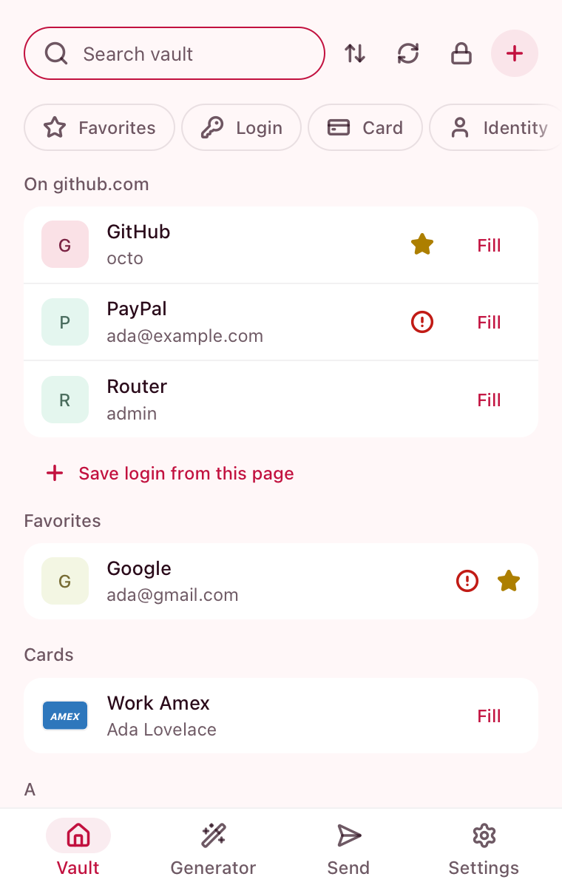
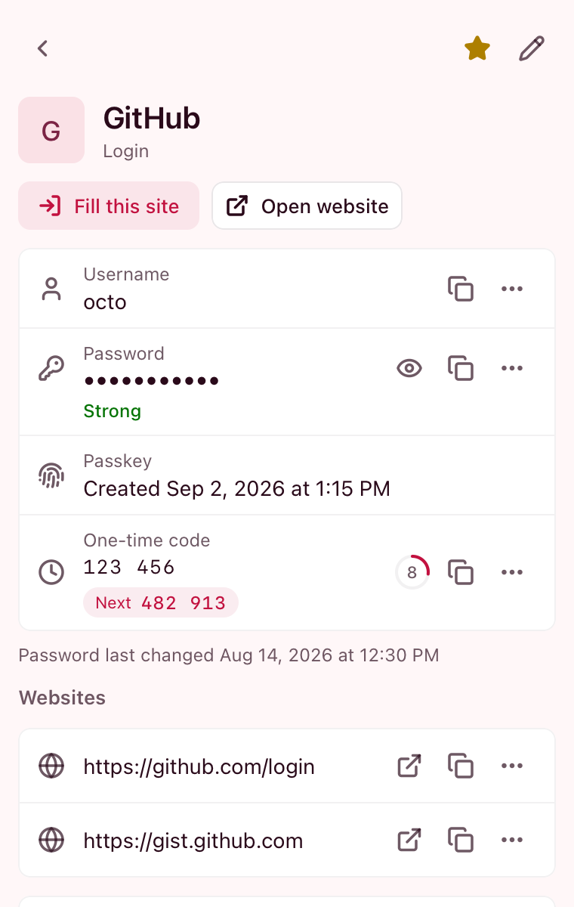
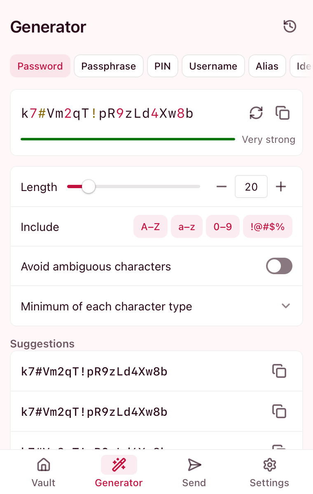

<p align="center">
  <picture>
    <source media="(prefers-color-scheme: dark)" srcset="brand/logo-horizontal-dark.svg">
    
  </picture>
</p>

<p align="center"><b>Made for Vaultwarden.</b></p>

Warren is a small, quick password manager for Chromium browsers that talks to one server: your own
[Vaultwarden](https://github.com/dani-garcia/vaultwarden). No account elsewhere, no telemetry, no UI framework.
Your vault is decrypted only in memory and locks itself when you walk away.

> [!WARNING]
> **Warren is in early testing and may not be ready for wide use.** It is provided as is, without warranty of any
> kind, and the authors accept no liability for lost data or any other damage (GPL-3.0 sections 15 and 16). Keep an
> export of your vault and another client at hand.
>
> Warren is an unofficial client and is not affiliated with Bitwarden, Inc. or the Vaultwarden project.

**Server:** the latest Vaultwarden release only. Older releases are neither tested nor supported.

## Screenshots

<p align="center">
<picture>
  <source media="(prefers-color-scheme: dark)" srcset="docs/screenshots/dark-list.png">
  
</picture>
<picture>
  <source media="(prefers-color-scheme: dark)" srcset="docs/screenshots/dark-item.png">
  
</picture>
<picture>
  <source media="(prefers-color-scheme: dark)" srcset="docs/screenshots/dark-generator.png">
  
</picture>
</p>

Rendered from the popup with a stubbed worker (`node dev/preview/build.mjs && node dev/preview/shot.mjs`).

## What it does

**Vault**
- Logins, cards (with network marks), identities, secure notes, SSH keys, bank accounts, driver's licenses and
  passports: view, edit, clone, search, folders, favorites, archive, trash, password history, custom fields, attachments
  (add, download, delete).
- A list that puts "On this site" first, then favorites and recently opened; copy, open and fill buttons on every
  row. Click a field in the item view to copy it.
- Organizations: items in collections, move a personal item into an organization, change an item's collections.
- Live sync over Vaultwarden's notifications; changes from other clients show immediately.
- Import and export: Bitwarden JSON, password-protected JSON and CSV; import also reads the CSV exports of Chrome,
  Firefox, LastPass, 1Password, Keeper, KeePassXC, Proton Pass, NordPass and RoboForm.
- Security report: reused, weak and non-https logins, sites that offer two-step codes you have not set up, and an
  on-demand breach check of passwords (only 5 characters of each hash leave the device) and of login e-mail addresses
  (through your server's HIBP key).

**Autofill and passkeys**
- Fill from the popup, `Ctrl+Shift+L` (`⌘⇧L` on macOS), the context menu or an inline menu on the field; optional
  page-load fill, TOTP code copied after a fill, and autosubmit that never presses a destructive button.
- The inline menu also works inside modal dialogs, closed shadow roots and a checkout's one-field iframes (a card
  pick fills every frame of the payment form), and offers a new e-mail alias on registration forms.
- Offers to save or update a login after you sign in, also on two-step sign-ins; "Change password on this site"
  opens the site's own page.
- Blocked sites (no inline menu, page-load fill or passkey prompt) and never-save sites you can list by hand.
- Passkeys: create and use passkeys stored in your vault, or add one to an existing login; also in sign-in frames a
  site embeds from another domain. Automatic passkey upgrades join the login Warren just filled, a site's account
  rename updates the passkey, and biometric unlock verifies you instead of the master password.

**Tools**
- TOTP codes with the next code shown, QR code and large type views, data-breach check, typing practice for a
  new password.
- Password, passphrase, username and identity generators (identities by country), generator history, email
  aliases, Send (text and files, with edit and disable).

**Sign-in and locking**
- Master password, PIN or biometrics (WebAuthn PRF); auto-lock or log out on a timeout, on system lock and on
  browser start; re-prompt for the master password on protected items.
- Two-step login (authenticator, email, YubiKey, Duo, WebAuthn), SSO, and log in with another device, including
  approving requests from other devices.
- Copied values are cleared after a minute by default.

**Interface**
- Popup or side panel; system, light, dark and pure black themes, compact mode, adjustable width, website icons
  (off by default), toolbar badge with the number of logins for the page.

## Install

Chromium 156 or newer. Download `warren-vX.Y.Z.crx` from the
[latest release](https://github.com/zoltrons/warren/releases/latest). Stock Chrome refuses hand-installed `.crx`
files; [docs/UPDATES.md](docs/UPDATES.md) shows how to install through browser policy so it also keeps itself up
to date. For a quick look, unzip `warren-vX.Y.Z.zip` and use **Load unpacked** on `chrome://extensions`.

## Build

Needs Node 24, rustup, `wasm-bindgen-cli` at the version in `upstream.lock` and binaryen (`wasm-opt`, installed by `npm ci`).

```sh
npm ci
npm run build:wasm          # Rust crypto + autofill engine → dist/wasm
node tools/fetch-psl.mjs    # public suffix list, once
npm run build               # → dist/ext, load it unpacked
npm run check               # types + unit tests + contrast
node tools/verify.mjs push  # everything CI checks, before a push
```

Every check runs through `tools/verify.mjs` (e2e against a real Vaultwarden: `bash dev/vaultwarden/up.sh`, then
`node tools/verify.mjs e2e`). The full list is in [AGENTS.md](AGENTS.md).
How it is put together: [docs/ARCHITECTURE.md](docs/ARCHITECTURE.md). What has to stay true:
[docs/SECURITY.md](docs/SECURITY.md), checked in [docs/VERIFICATION.md](docs/VERIFICATION.md). Server quirks:
[docs/COMPATIBILITY.md](docs/COMPATIBILITY.md).

## Credits and license

Warren speaks the Bitwarden client protocol and uses Bitwarden's
[`bitwarden-crypto`](https://github.com/bitwarden/sdk-internal) crate under its GPL-3.0 option. Icons in the
interface come from Lucide (ISC). Details: [docs/LICENSING.md](docs/LICENSING.md).

Warren is free software under the [GNU GPL v3](LICENSE) (GPL-3.0-only); third-party notices are in
[NOTICE](NOTICE). It is not a fork: it is written from scratch, and other password managers are idea references
only. Their code is never copied.
